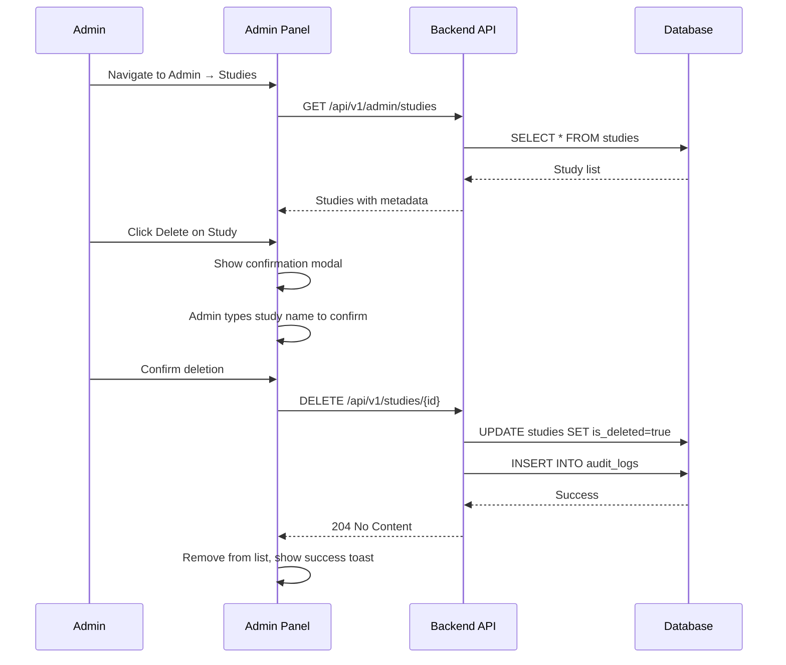

# Technical Architecture Plan: Study & Document Management Features

**Version:** 1.0  
**Date:** 2025-12-06  
**Author:** Technical Architect  
**Status:** DRAFT - Pending Review

---

## 📋 Executive Summary

This document outlines the technical architecture for implementing two key features:
1. **Admin Study Deletion** - Allow admin users to delete studies from the Admin Settings page
2. **Study Document Management** - Enable users to delete uploaded documents and receive intelligent duplicate file warnings

---

## 🎯 Feature 1: Admin Study Deletion

### 1.1 Current State Analysis

✅ **Already Implemented (Backend):**
- `DELETE /api/v1/studies/{study_id}` endpoint exists in `studies.py`
- `StudyService.delete_study()` performs GDPR-compliant soft delete
- Requires admin permission validation
- Audit logging infrastructure in place

❌ **Missing (Frontend):**
- No UI for study deletion in Admin Panel
- No study list with delete action in admin context
- No confirmation dialogs for destructive operations

### 1.2 Proposed Architecture

```
┌──────────────────────────────────────────────────────────────────┐
│                     ADMIN PANEL (Frontend)                        │
├──────────────────────────────────────────────────────────────────┤
│  ┌─────────────┐  ┌─────────────┐  ┌─────────────┐              │
│  │  Dashboard  │  │    Users    │  │   Studies   │  ← NEW TAB   │
│  └─────────────┘  └─────────────┘  └─────────────┘              │
│                                            │                      │
│                          ┌─────────────────▼──────────────────┐  │
│                          │     StudyManagement Component      │  │
│                          │                                    │  │
│                          │  ┌──────────────────────────────┐  │  │
│                          │  │  Study List Table            │  │  │
│                          │  │  - ID, Name, Status, Actions │  │  │
│                          │  │  - [View] [Delete]           │  │  │
│                          │  └──────────────────────────────┘  │  │
│                          │                                    │  │
│                          │  ┌──────────────────────────────┐  │  │
│                          │  │  Delete Confirmation Modal   │  │  │
│                          │  │  - Study details             │  │  │
│                          │  │  - Impact warning            │  │  │
│                          │  │  - Type study name confirm   │  │  │
│                          │  └──────────────────────────────┘  │  │
│                          └────────────────────────────────────┘  │
└──────────────────────────────────────────────────────────────────┘
                                    │
                                    ▼
┌──────────────────────────────────────────────────────────────────┐
│                        API LAYER                                  │
├──────────────────────────────────────────────────────────────────┤
│  GET  /api/v1/admin/studies       → List all studies (admin)    │
│  DELETE /api/v1/studies/{id}      → Soft delete study (existing) │
│  DELETE /api/v1/admin/studies/{id}/hard → Hard delete (new)     │
└──────────────────────────────────────────────────────────────────┘
                                    │
                                    ▼
┌──────────────────────────────────────────────────────────────────┐
│                     DATABASE LAYER                                │
├──────────────────────────────────────────────────────────────────┤
│  studies table:                                                   │
│  - is_deleted: boolean (soft delete marker)                       │
│  - deleted_at: timestamp                                          │
│  - deleted_by: user_id (NEW - for audit)                         │
│                                                                   │
│  Cascade: study_documents, study_datasets, study_access          │
└──────────────────────────────────────────────────────────────────┘
```

### 1.3 Implementation Tasks

#### Backend Tasks:

| Task | File | Description | Priority |
|------|------|-------------|----------|
| B1.1 | `admin.py` | Add `GET /api/v1/admin/studies` endpoint to list all studies | HIGH |
| B1.2 | `admin.py` | Add `DELETE /api/v1/admin/studies/{id}/hard` for permanent deletion | MEDIUM |
| B1.3 | `study_service.py` | Add `deleted_by` field tracking | LOW |
| B1.4 | `study_service.py` | Add cascade delete for related documents/datasets | HIGH |

#### Frontend Tasks:

| Task | File | Description | Priority |
|------|------|-------------|----------|
| F1.1 | `admin/StudyManagement.tsx` | Create new component for study list | HIGH |
| F1.2 | `AdminPanel.tsx` | Add "Studies" tab to admin panel | HIGH |
| F1.3 | `admin/StudyManagement.tsx` | Implement delete confirmation modal | HIGH |
| F1.4 | `services/adminApi.ts` | Add admin study API functions | HIGH |

### 1.4 User Flow



### 1.5 Security Considerations

- ✅ Admin role verification on all endpoints
- ✅ Audit logging for compliance (21 CFR Part 11)
- ✅ Soft delete by default (GDPR compliant)
- ✅ Confirmation required (type study name)
- ✅ Cannot delete own active study (prevent accidental data loss)

---

## 🎯 Feature 2: Study Document Management with Duplicate Detection

### 2.1 Current State Analysis

✅ **Already Implemented (Backend):**
- `DELETE /api/v1/studies/{study_id}/documents/{doc_id}` exists
- `DocumentService.delete_document()` supports soft/hard delete
- Document metadata stored in database

❌ **Missing:**
- No delete button in "Upload Study Documents" UI
- No duplicate file detection logic
- No warnings for duplicate uploads

### 2.2 Proposed Architecture

```
┌──────────────────────────────────────────────────────────────────┐
│               UPLOAD STUDY DOCUMENTS (Frontend)                   │
├──────────────────────────────────────────────────────────────────┤
│                                                                   │
│  ┌────────────────────────────────────────────────────────────┐  │
│  │  Document Upload Area                                       │  │
│  │  ┌──────────────────────────────────────────────────────┐  │  │
│  │  │  [📁 Drop files or click to upload]                  │  │  │
│  │  └──────────────────────────────────────────────────────┘  │  │
│  └────────────────────────────────────────────────────────────┘  │
│                                                                   │
│  ┌────────────────────────────────────────────────────────────┐  │
│  │  Duplicate Warning Banner (Conditional)          ⚠️ NEW   │  │
│  │  "2 files appear to be duplicates: ADSLSpec.xlsx"         │  │
│  │  [Keep Original] [Replace] [Keep Both]                    │  │
│  └────────────────────────────────────────────────────────────┘  │
│                                                                   │
│  ┌────────────────────────────────────────────────────────────┐  │
│  │  Uploaded Documents List                                   │  │
│  │  ┌──────────────────────────────────────────────────────┐  │  │
│  │  │ 📄 ADSLSpec.xlsx           SPEC    1.2MB    [🗑️]    │  │  │ ← DELETE BTN
│  │  │ 📄 Protocol_v2.pdf         SAP     3.4MB    [🗑️]    │  │  │
│  │  │ 📄 SDTM_Mapping.xlsx       SDTM    0.8MB    [🗑️]    │  │  │
│  │  └──────────────────────────────────────────────────────┘  │  │
│  │                                                             │  │
│  │  ⚠️ Potential duplicates:                        🔍 NEW   │  │
│  │  • ADSLSpec.xlsx (uploaded 2x - Dec 5, Dec 6)              │  │
│  └────────────────────────────────────────────────────────────┘  │
│                                                                   │
└──────────────────────────────────────────────────────────────────┘
```

### 2.3 Duplicate Detection Algorithm

```python
class DuplicateDetector:
    """
    Intelligent duplicate file detection for study documents
    """
    
    def detect_duplicates(self, study_id: str, new_file: UploadFile) -> DuplicateInfo:
        """
        Detection Strategy (Priority Order):
        
        1. EXACT MATCH (Highest Confidence)
           - Same file hash (SHA-256)
           - Confidence: 100%
           
        2. NAME MATCH (High Confidence)
           - Same filename (case-insensitive)
           - Different upload date
           - Confidence: 90%
           
        3. CONTENT SIMILARITY (Medium Confidence)
           - Same file extension
           - Similar file size (±10%)
           - Levenshtein distance on filename ≤ 3
           - Confidence: 70%
           
        4. SEMANTIC MATCH (Lower Confidence)
           - Same document_type (SPECIFICATION, SAP, etc.)
           - Similar naming pattern (e.g., "ADSL_Spec_v1" vs "ADSL_Spec_v2")
           - Confidence: 50%
        """
        pass
```

### 2.4 UI/UX Design

#### Delete Button States:
```
┌─────────────────────────────────────────────────┐
│  Document Item                                   │
│  ┌─────────────────────────────────────────────┐│
│  │ 📄 Filename.xlsx                            ││
│  │ Type: SPECIFICATION  |  Size: 1.2 MB        ││
│  │ Uploaded: Dec 6, 2025                       ││
│  │                                              ││
│  │ ┌──────────────┐  ┌──────────────────────┐ ││
│  │ │ 👁️ Preview  │  │ 🗑️ Delete (hover:red) │ ││
│  │ └──────────────┘  └──────────────────────┘ ││
│  └─────────────────────────────────────────────┘│
└─────────────────────────────────────────────────┘

On Delete Click:
┌─────────────────────────────────────────────────┐
│  ⚠️ Delete Document?                            │
│                                                  │
│  Are you sure you want to delete:               │
│  "Oncology_ADaM_Spec_ADSL.xlsx"                 │
│                                                  │
│  ⚠️ This will remove the document from this    │
│  study. If this is the active specification,    │
│  you'll need to select a new one.               │
│                                                  │
│  ┌─────────────┐  ┌─────────────────────────┐   │
│  │   Cancel    │  │  🗑️ Delete Document    │   │
│  └─────────────┘  └─────────────────────────┘   │
└─────────────────────────────────────────────────┘
```

#### Duplicate Warning Banner:
```
┌─────────────────────────────────────────────────────────────────┐
│  ⚠️ DUPLICATE DETECTED                                          │
│                                                                  │
│  The file "ADSLSpec.xlsx" appears to be a duplicate of:        │
│  • ADSLSpec.xlsx (uploaded Dec 5, 2025)                         │
│                                                                  │
│  What would you like to do?                                      │
│                                                                  │
│  ┌────────────────┐ ┌────────────────┐ ┌────────────────────┐   │
│  │ Keep Original  │ │ Replace Older  │ │ Keep Both (rename) │   │
│  └────────────────┘ └────────────────┘ └────────────────────┘   │
│                                                                  │
│  💡 Tip: Keeping multiple spec versions may cause confusion     │
│  during pair programming.                                        │
└─────────────────────────────────────────────────────────────────┘
```

### 2.5 Implementation Tasks

#### Backend Tasks:

| Task | File | Description | Priority |
|------|------|-------------|----------|
| B2.1 | `document_service.py` | Add `check_duplicates()` method | HIGH |
| B2.2 | `document_service.py` | Implement hash-based duplicate detection | HIGH |
| B2.3 | `study_documents.py` | Add `/check-duplicate` endpoint | HIGH |
| B2.4 | `study_documents.py` | Add duplicate info in upload response | MEDIUM |
| B2.5 | `schemas/study.py` | Add `DuplicateInfo` response schema | MEDIUM |

#### Frontend Tasks:

| Task | File | Description | Priority |
|------|------|-------------|----------|
| F2.1 | `EnterStudyDetailsPageEnhanced.tsx` | Add delete button to document items | HIGH |
| F2.2 | `EnterStudyDetailsPageEnhanced.tsx` | Add delete confirmation modal | HIGH |
| F2.3 | `EnterStudyDetailsPageEnhanced.tsx` | Implement duplicate warning banner | HIGH |
| F2.4 | `EnterStudyDetailsPageEnhanced.tsx` | Add duplicate resolution actions | MEDIUM |
| F2.5 | `store/studyStore.ts` | Add `deleteDocument` action | HIGH |
| F2.6 | `services/studyApi.ts` | Add delete document API call | HIGH |
| F2.7 | `EnterStudyDetailsPage.css` | Style delete buttons and warnings | LOW |

### 2.6 API Contracts

#### Check for Duplicates (Pre-upload):
```http
POST /api/v1/studies/{study_id}/documents/check-duplicate
Content-Type: application/json

{
  "filename": "ADSLSpec.xlsx",
  "file_size": 125000,
  "file_hash": "sha256:abc123..."  // Optional, for exact match
}

Response 200:
{
  "has_duplicates": true,
  "duplicates": [
    {
      "document_id": "doc-123",
      "filename": "ADSLSpec.xlsx",
      "uploaded_at": "2025-12-05T10:30:00Z",
      "match_type": "exact_name",
      "confidence": 90
    }
  ],
  "recommended_action": "replace"
}
```

#### Delete Document:
```http
DELETE /api/v1/studies/{study_id}/documents/{document_id}?hard_delete=false

Response 204: No Content

Response 400 (if active spec):
{
  "detail": "Cannot delete active specification. Select a different specification first.",
  "code": "ACTIVE_SPEC_DELETE"
}
```

---

## 📊 Data Models

### New/Modified Schemas:

```typescript
// Frontend Types
interface DuplicateInfo {
  document_id: string;
  filename: string;
  uploaded_at: string;
  match_type: 'exact_hash' | 'exact_name' | 'similar_name' | 'same_type';
  confidence: number; // 0-100
  size_bytes: number;
}

interface DuplicateCheckResponse {
  has_duplicates: boolean;
  duplicates: DuplicateInfo[];
  recommended_action: 'replace' | 'keep_both' | 'cancel';
}

interface DeleteDocumentRequest {
  hard_delete: boolean;
  force?: boolean; // For deleting active spec
  replacement_doc_id?: string; // If deleting active spec, which to replace with
}
```

```python
# Backend Models
class DuplicateInfo(BaseModel):
    document_id: str
    filename: str
    uploaded_at: datetime
    match_type: Literal["exact_hash", "exact_name", "similar_name", "same_type"]
    confidence: int = Field(ge=0, le=100)
    size_bytes: int

class DuplicateCheckResponse(BaseModel):
    has_duplicates: bool
    duplicates: List[DuplicateInfo]
    recommended_action: Literal["replace", "keep_both", "cancel"]
```

---

## 🔐 Security & Compliance

### Audit Trail Requirements (21 CFR Part 11):

| Action | Audit Fields |
|--------|--------------|
| Study Delete | user_id, study_id, timestamp, ip_address, user_agent, deletion_type |
| Document Delete | user_id, study_id, document_id, filename, timestamp, was_active_spec |
| Duplicate Resolution | user_id, action_taken, original_doc_id, new_doc_id |

### Permission Matrix:

| Action | Viewer | Editor | Admin |
|--------|--------|--------|-------|
| View Documents | ✅ | ✅ | ✅ |
| Upload Documents | ❌ | ✅ | ✅ |
| Delete Documents | ❌ | ✅ | ✅ |
| Delete Study | ❌ | ❌ | ✅ |
| Hard Delete Study | ❌ | ❌ | ✅* |

*Requires additional confirmation

---

## 🧪 Testing Strategy

### Unit Tests:
- `test_duplicate_detector.py` - Test all duplicate detection scenarios
- `test_document_deletion.py` - Test soft/hard delete, cascade behavior
- `test_admin_study_management.py` - Test study listing and deletion

### Integration Tests:
- Full upload → duplicate detection → resolution flow
- Delete study with documents → verify cascade
- Delete active specification → verify fallback behavior

### E2E Tests:
- Admin deletes study via UI
- User uploads duplicate file → sees warning → resolves
- User deletes document → confirmation → success

---

## 📅 Implementation Timeline

### Phase 1: Core Functionality (Week 1)
- [ ] B2.1, F2.1, F2.2 - Document deletion basic flow
- [ ] F2.5, F2.6 - API integration for deletion
- [ ] B1.1, F1.1, F1.2 - Admin study management tab

### Phase 2: Intelligence Layer (Week 2)
- [ ] B2.1, B2.2, B2.3 - Duplicate detection backend
- [ ] F2.3, F2.4 - Duplicate warning UI
- [ ] B1.2, B1.4 - Hard delete and cascade

### Phase 3: Polish & Testing (Week 3)
- [ ] F1.3, F1.4 - Safe delete confirmation with type-to-confirm
- [ ] F2.7 - UI polish and animations
- [ ] All tests

---

## ✅ Stakeholder Decisions (2025-12-06)

| Question | Decision |
|----------|----------|
| **Retention Policy** | Hard delete immediately - no retention period |
| **Active Spec Deletion** | Option B: Allow with warning + prompt to select replacement |
| **Bulk Operations** | Yes - admins can bulk-delete multiple studies |
| **Recycle Bin** | Yes - implement Trash view for admins to see/restore deleted items |
| **Notifications** | No - don't notify collaborators when study is deleted |

---

## 📝 Change Log

| Version | Date | Author | Changes |
|---------|------|--------|---------|
| 1.0 | 2025-12-06 | Architect | Initial draft |
| 1.1 | 2025-12-06 | Implementation | ✅ Backend: Admin study management APIs implemented |
| 1.2 | 2025-12-06 | Implementation | ✅ Backend: Duplicate detection endpoint added |
| 1.3 | 2025-12-06 | Implementation | ✅ Frontend: StudyManagement component created |
| 1.4 | 2025-12-06 | Implementation | ✅ Frontend: Admin Panel updated with Studies tab |
| 1.5 | 2025-12-06 | Implementation | ✅ Frontend: Document delete button added |

---

## ✅ Implementation Status

### Backend (Complete)
- [x] `GET /api/v1/admin/studies` - List all studies for admin
- [x] `GET /api/v1/admin/studies/trash` - List deleted studies (Recycle Bin)
- [x] `POST /api/v1/admin/studies/{id}/restore` - Restore from trash
- [x] `DELETE /api/v1/admin/studies/{id}/hard` - Permanent delete
- [x] `POST /api/v1/admin/studies/bulk-delete` - Bulk delete
- [x] `POST /api/v1/studies/{id}/documents/check-duplicate` - Duplicate detection

### Frontend (Complete)
- [x] `StudyManagement.tsx` - Admin component for study management
- [x] `AdminPanel.tsx` - Added "Studies" tab
- [x] `EnterStudyDetailsPageEnhanced.tsx` - Delete button on documents
- [x] Type-to-confirm delete modal for permanent deletion

---

*This document is subject to review and approval before implementation begins.*
