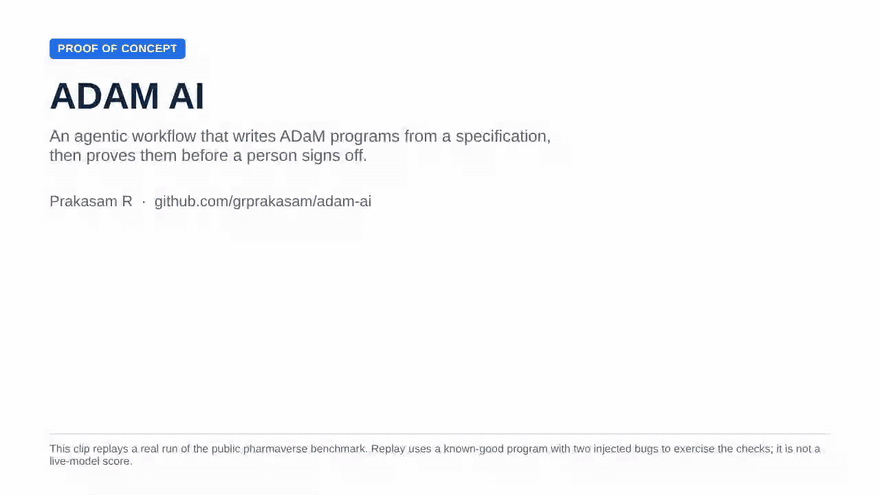
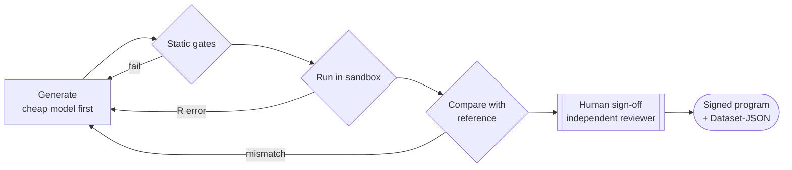

# ADAM AI

[](https://github.com/grprakasam/adam-ai/actions/workflows/adam-agent-ci.yml)
[](https://github.com/grprakasam/adam-ai/actions/workflows/agent-workbench.yml)

**A LangGraph agent that turns a CDISC ADaM specification into an R program, proves the output against an independent reference, and stops for an independent human sign-off.**

`Python` · `LangGraph` · `FastAPI` · `OpenAI / Anthropic / Gemini / Amazon Bedrock / Azure OpenAI` · `MCP` · `R` · `Docker` · `GitHub Actions` · `React + TypeScript`

## Demo



A one-minute walkthrough of a real run of the public pharmaverse benchmark. The first draft carries two injected bugs (an off-by-one treatment duration and a wrong age cut-off); the comparison with the reference catches them, one repair loop fixes them, and all 28 ADSL variables match for all 306 subjects. Replay mode exercises the checks with a known-good program; it is not a live-model score. [MP4 version](docs/demo/adam-ai-demo.mp4).

**App walkthrough (3 min):** a live tour of the app's screens on public CDISC pilot data: study setup, spec upload, pair programmer, traceability, QC tools, submission checks and the agent workbench. [Watch it](https://grprakasam.github.io/walkthrough.html).

## Agentic ADaM pipeline



* **Capped repair loop**: failures (sandbox violations, R errors, mismatched
  variables with example subjects) are fed back to the model, then escalated to a
  stronger model and finally to a person.
* **QC-grade evaluation**: exact match overall and per variable, as in
  double-programming QC.
* **Strict by default**: the API requires Docker execution, an independent
  reference, exact agreement and an independent reviewer; failed checks cannot be
  approved away ([ADR 0010](docs/adr/0010-strict-verification-and-durable-review.md)).
* **Durable human review**: paused reviews are checkpointed in SQLite and resume
  after a restart; a small review workbench (`/agent.html`) shows gates, code and
  cost.
* **Sandboxed execution**: generated R runs in a container with no network, a
  read-only root filesystem and dropped capabilities.
* **Audit and cost**: hash-chained audit log (prompt, response and code SHA-256,
  model version, reviewer) and tokens/USD/INR per dataset.
* **Models**: cheap-first routing across OpenAI, Anthropic, Gemini, Groq,
  OpenRouter, Ollama, **Amazon Bedrock** (Converse API with prompt caching) and
  **Azure OpenAI**; optional **Langfuse** tracing.
* **MCP server**: the deterministic checks are available to any MCP client.

The agent generates R. SAS programs come from the base generator described below.

### Verify it yourself

**Public benchmark** ([`benchmarks/pharmaverse`](benchmarks/pharmaverse)): pharmaversesdtm v1.5.0 →
ADSL vs pharmaverseadam v1.4.0, 28 variables × 306 subjects, run in CI on every
push. Replay (harness validation): **100% match after 1 repair loop** — see the
[latest scorecard](benchmarks/pharmaverse/results/latest_replay.md).

```bash
python benchmarks/pharmaverse/run_benchmark.py --mode replay --replay-fault --min-match 1.0
python benchmarks/pharmaverse/run_benchmark.py --mode live --max-attempts 3   # scores a real model
```

Docs: [architecture](docs/architecture/agentic-pipeline.md) ·
[decision records](docs/adr/README.md) · [benchmark](benchmarks/pharmaverse/README.md)

### Evidence and limits

Replay validates the harness with a known-good program; it is not a model score.
Bedrock and Azure calls are tested with fake SDK clients; no Azure tenant request has been made.
The checkpointer is single-host, and the audit log is not a regulated audit system.
Live model accuracy on the public benchmark and production throughput are not yet
measured. Details are in [ADR 0010](docs/adr/0010-strict-verification-and-durable-review.md).

**Time saved (internal trial, self-measured).** In my own trial runs of the copilot
mode on ADSL and ADAE, a first-draft program took about 20 minutes, compared with
about two days to write one by hand. These timings are mine, are not independently
verified, and exclude review and QC time.

## Base application

The agent sits inside a larger FastAPI + React application for ADaM programming:

- **Multi-LLM support**: OpenAI, Anthropic Claude, Google Gemini, Groq, OpenRouter, Ollama, Amazon Bedrock, Azure OpenAI
- **SDTM to ADaM conversion** with rule-based generation that follows the CDISC ADaM implementation guide
- **R and SAS code generation** with syntax and compliance checks
- **REST API** (FastAPI) and a React + TypeScript frontend with the Monaco editor
- **Authentication and security**: JWT auth, rate limiting, Pydantic input validation

## Project structure

```
adam-ai/
├── backend/              # FastAPI backend service
│   ├── app/             # Application code
│   │   ├── api/         # API endpoints
│   │   ├── core/        # Core utilities (auth, validation, etc.)
│   │   ├── models/      # Pydantic models
│   │   ├── modules/     # Business logic modules (adam_agent/ is the agent)
│   │   └── main.py      # FastAPI application
│   ├── tests/           # Test suite
│   ├── scripts/         # Utility scripts
│   └── requirements.txt # Python dependencies
├── frontend/            # React + TypeScript frontend (agent.html is the review workbench)
├── benchmarks/          # Public pharmaverse benchmark (ADSL) and CI quality gate
├── docs/                # Architecture notes, decision records (ADRs), historical dev notes
├── scripts/dev/         # Manual smoke scripts (not part of CI)
├── Context/             # CDISC ADaM rules and architecture documentation
├── Content/             # User inputs (specifications are not included)
└── README.md
```

## Data in this repository

All clinical data here is public or synthetic: the CDISC pilot study (`CDISCPILOT01`, via pharmaverse) and generated test data (`STUDY001`). Sample specification spreadsheets are not included. To try the agent, use the public pharmaverse benchmark in [`benchmarks/pharmaverse`](benchmarks/pharmaverse), which ships its own ADSL spec, SDTM inputs and reference dataset, or upload your own specification in the app.

## Ownership and history

ADAM AI is a personal project, not a company initiative. I started it with a few
colleagues in November 2025 and did all of the development in my personal GitHub
account. I have demonstrated it to my employer's leadership team to show what AI
can do for ADaM programming. Development was private until October 2026; the
public history starts then, after colleague-authored files were removed. Claude
Code is my pair programmer: it drafts code and tests; I set the design (recorded
in the [decision records](docs/adr/README.md)), review every change and decide
what ships.

## Quick start

### Prerequisites

- **Python 3.13+** (backend)
- **Node.js 18+** and **npm** (frontend)
- An API key for at least one LLM provider (OpenAI, Anthropic, Google, Amazon Bedrock or Azure OpenAI)
- **Docker** for strict agent runs

### Backend

```powershell
cd backend
python -m venv prakenv
.\prakenv\Scripts\Activate.ps1
pip install -r requirements.txt
```

Create `backend/.env` (see `backend/.env.example`):

```env
# LLM API keys (at least one required)
OPENAI_API_KEY=your_openai_api_key_here
ANTHROPIC_API_KEY=your_anthropic_api_key_here
GOOGLE_API_KEY=your_google_api_key_here

# Default LLM configuration
DEFAULT_LLM_PROVIDER=google
DEFAULT_MODEL=gemini-2.5-flash
DEFAULT_TEMPERATURE=0.2
DEFAULT_MAX_TOKENS=4000

# Server
HOST=0.0.0.0
PORT=8000
DEBUG=False
```

Run the API:

```powershell
cd backend
..\prakenv\Scripts\python.exe -m uvicorn app.main:app --reload --host 0.0.0.0 --port 8000
```

- API base: http://localhost:8000/api/v1
- Swagger: http://localhost:8000/api/docs
- ReDoc: http://localhost:8000/api/redoc

On Windows, `start_servers.ps1` starts both servers.

### Frontend

```powershell
cd frontend
npm install
npm run dev        # http://localhost:5173
```

## Testing

```powershell
.\prakenv\Scripts\python.exe -m pytest backend\tests\ -v      # backend
cd frontend; npm run lint; npm run build                       # frontend
```

CI runs the agent unit tests, the MCP server tests, the replay benchmark and the workbench build.

## Architecture

### Backend modules

1. **Input collection**: SDTM datasets and specifications
2. **Rule loading**: ADaM rules from markdown files
3. **Context building**: aggregates inputs and rules
4. **Prompt engineering**: builds prompts for the LLM
5. **LLM integration**: multiple providers behind one interface
6. **Code generation**: orchestrates the generation workflow
7. **Validation**: syntax and CDISC compliance checks
8. **ADaM agent** (`modules/adam_agent`): LangGraph pipeline, routing, audit, cost, MCP server

### Frontend components

- **Setup**: study metadata and generation options
- **Datasets and variables**: SDTM dataset and variable selection
- **Rules**: CDISC rule display
- **Code editor**: Monaco with syntax highlighting
- **Validation results and quality metrics**
- **AI chat assistant**
- **Agent review workbench** (`/agent.html`)

## Development

- Backend: PEP 8 with type hints; format with `black app/`, lint with `flake8 app/`
- Frontend: TypeScript strict mode; `npm run lint`
- Logging: `loguru` to the console and `backend/logs/adam_ai.log` (10 MB rotation)
- Dependencies: see `backend/requirements*.txt` and `frontend/package.json`

## Troubleshooting

- **PowerShell execution policy**: use `.\prakenv\Scripts\python.exe` directly, or run
  `Set-ExecutionPolicy -ExecutionPolicy RemoteSigned -Scope CurrentUser`.
- **Import errors**: check you are using the virtual environment's Python.
- **API keys**: `.env` must be in `backend/` with at least one provider key.

## License

Proprietary.

## Author

Prakasam R · [github.com/grprakasam](https://github.com/grprakasam) · [linkedin.com/in/grprakasam](https://www.linkedin.com/in/grprakasam)
