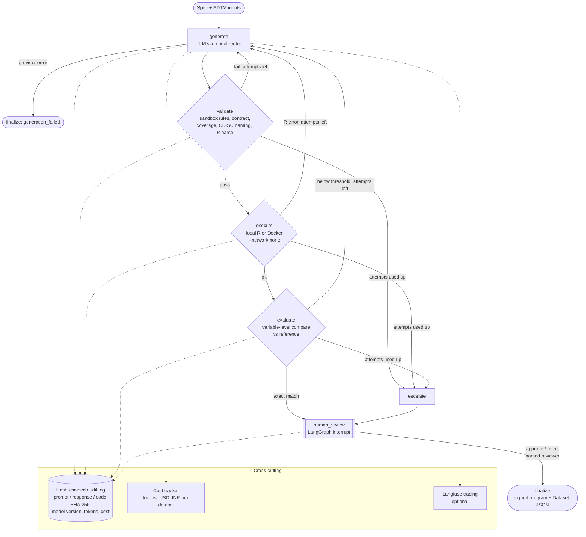

# Agentic ADaM pipeline (v2)

ADAM AI v2 adds an agentic generation pipeline on top of the existing modules.
A model proposes an R program, deterministic gates check it, the program runs in a
sandbox, the output is compared with a reference dataset, and a named human signs
it off. Every step is written to a hash-chained audit log.

Code: `backend/app/modules/adam_agent/` · API: `/api/v1/adam-agent/*` ·
Benchmark: `benchmarks/pharmaverse/` · Decisions: `docs/adr/`

## Flow



Repair prompts quote the concrete failure: the static errors, the tail of the R
error output, or the variables that disagree with the reference (with example
subjects). The router starts on a cheap model and moves up one tier per failed
attempt.

## Components

| Module | Responsibility |
|---|---|
| `workflow.py` | LangGraph `StateGraph`, routing, repair cap, `interrupt()` for sign-off, `AdamAgent.start/review/get_state` |
| `components.py` | `LLMCodeGenerator` (existing multi-provider service), `ReplayGenerator`, `StaticValidator`, `RExecutor` (local or Docker) |
| `compare.py` | Variable-level comparison (diffdf-style): key alignment, normalisation, match rates, mismatch examples |
| `routing.py` | Cheap-first model routing (`ADAM_AGENT_ROUTES`) |
| `cost.py`, `pricing.yaml` | Token and cost tracking in USD and INR |
| `audit.py` | Append-only JSONL audit log with SHA-256 chaining and `verify_chain()` |
| `tracing.py` | Optional Langfuse spans (no-op when not configured) |
| `dataset_json.py` | CDISC Dataset-JSON v1.1 output for approved runs |
| `mcp_server.py` | MCP tools for the deterministic checks (separate process) |
| `paths.py` | Allowed data folders for API/MCP paths (blocks traversal) |
| `llm_integration/service.py` | New `BedrockProvider` (Converse API, optional prompt caching) |

## Controls for regulated use

* **Human in the loop:** runs pause at `human_review`. Sign-off needs a
  `senior_developer` or `admin`, and by default a different person from the
  requester (`ADAM_AGENT_REQUIRE_INDEPENDENT_REVIEW`). The API never auto-approves.
* **QC-grade evaluation:** with a reference dataset, the default bar is an exact
  match overall *and* per variable, as in double-programming QC.
* **Traceability:** each audit record links run, attempt, model version, prompt
  hash, response hash, code hash, reviewer and decision; tampering breaks the chain.
* **Sandboxing:** static rules block file, network, system and eval calls before
  execution; Docker mode adds `--network none` and a memory cap.
* **Scope note:** these controls support GxP expectations (ALCOA+) but do not by
  themselves make a validated 21 CFR Part 11 system; computer system validation
  of the deployed environment is still required.

## Running it

```bash
# API (inside the existing backend)
pip install -r backend/requirements.txt
POST /api/v1/adam-agent/runs            {"spec_yaml": "...", "sdtm_dir": "...", "reference_path": "..."}
POST /api/v1/adam-agent/runs/{id}/review {"decision": "approve", "comment": "..."}

# Benchmark (no API key)
python benchmarks/pharmaverse/run_benchmark.py --mode replay --replay-fault --min-match 1.0

# Benchmark with a model
ADAM_AGENT_ROUTES="anthropic:claude-haiku-5-5,anthropic:claude-sonnet-5-5" \
  python benchmarks/pharmaverse/run_benchmark.py --mode live

# MCP server (own environment)
pip install -r backend/requirements-mcp.txt
cd backend && python -m app.modules.adam_agent.mcp_server
```
